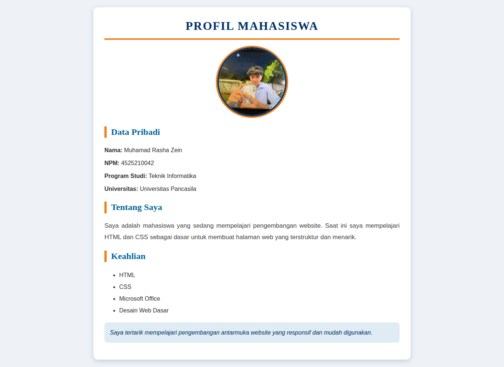
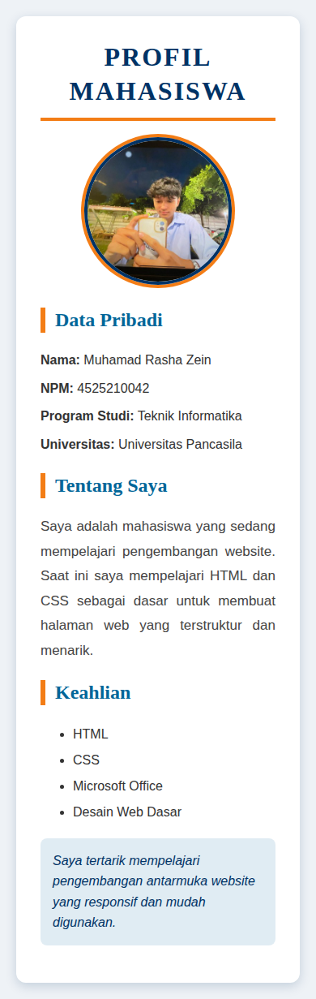
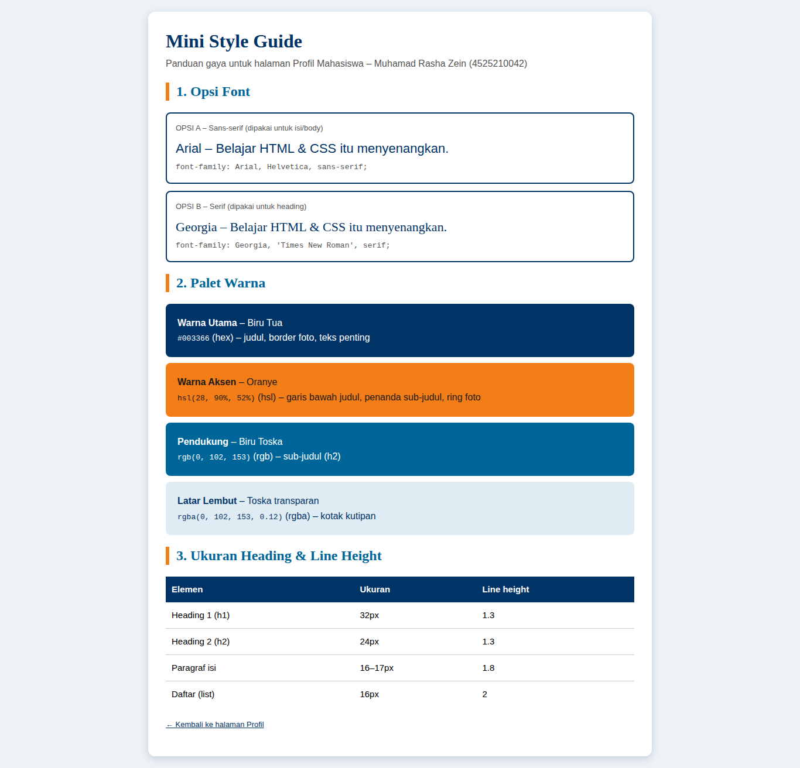
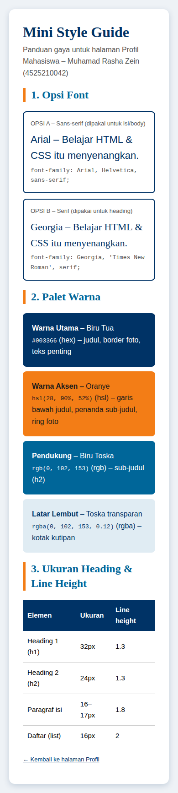

# Tugas Praktikum Pertemuan 3 - Desain Web

**Nama:** Muhamad Rasha Zein
**NPM:** 4525210042
**Kelas:** A

## Isi Tugas

**Individu**
1. Modifikasi Profil Pertemuan 3 dengan **10 property CSS inline** dan **4 format warna berbeda**.
2. Membuat **Mini Style Guide**: 2 opsi font, warna utama, warna aksen, ukuran heading, dan line height.

**Readme:** source code, hasil screenshot desktop/mobile, ringkasan kesimpulan 150-200 kata.

## File

| File | Keterangan |
|---|---|
| `index.html` | Halaman Profil Mahasiswa (sudah dimodifikasi, CSS inline) |
| `styleguide.html` | Mini Style Guide |
| `img/aca.jpg` | Foto profil |
| `screenshots/` | Hasil tampilan desktop dan mobile |

## 10 Property CSS Inline yang Digunakan

| No | Property | Contoh pemakaian |
|---|---|---|
| 1 | `font-family` | `Arial, Helvetica, sans-serif` (body), `Georgia, serif` (heading) |
| 2 | `color` | `#003366` pada judul |
| 3 | `background-color` | `#eef2f6` pada body, `#ffffff` pada kartu |
| 4 | `font-size` | `32px` (h1), `24px` (h2), `16px` (isi) |
| 5 | `line-height` | `1.6` body, `1.8` paragraf, `2` daftar |
| 6 | `text-align` | `center` pada judul, `justify` pada paragraf |
| 7 | `padding` | `30px` pada kartu, `15px` pada kotak kutipan |
| 8 | `margin` | `0 auto` untuk menengahkan kartu |
| 9 | `border-radius` | `12px` kartu, `50%` foto profil |
| 10 | `box-shadow` | `0 4px 14px rgba(0, 51, 102, 0.18)` pada kartu |

Property tambahan: `border`, `border-bottom`, `border-left`, `max-width`, `font-weight`, `font-style`, `text-transform`, `letter-spacing`.

## 4 Format Warna yang Digunakan

| Format | Contoh | Dipakai untuk |
|---|---|---|
| Hex | `#003366` | Warna utama: judul h1, border foto |
| RGB | `rgb(0, 102, 153)` | Warna sub-judul (h2) |
| RGBA | `rgba(0, 102, 153, 0.12)` | Latar kotak kutipan (transparan) |
| HSL | `hsl(28, 90%, 52%)` | Warna aksen: garis bawah judul, penanda h2, ring foto |

## Mini Style Guide

**Font**
- Opsi A (sans-serif, isi/body): `Arial, Helvetica, sans-serif`
- Opsi B (serif, heading): `Georgia, 'Times New Roman', serif`

**Warna**
- Utama: `#003366` (biru tua)
- Aksen: `hsl(28, 90%, 52%)` (oranye)
- Pendukung: `rgb(0, 102, 153)` dan `rgba(0, 102, 153, 0.12)`

**Ukuran heading dan line height**

| Elemen | Ukuran | Line height |
|---|---|---|
| h1 | 32px | 1.3 |
| h2 | 24px | 1.3 |
| Paragraf | 16-17px | 1.8 |
| Daftar | 16px | 2 |

Versi lengkap dengan contoh visual ada di `styleguide.html`.

## Screenshot

### Halaman Profil
| Desktop | Mobile |
|---|---|
|  |  |

### Mini Style Guide
| Desktop | Mobile |
|---|---|
|  |  |

## Ringkasan Kesimpulan

Pada tugas ini saya memodifikasi halaman Profil Mahasiswa dengan CSS inline, yaitu atribut style yang ditulis langsung pada tiap elemen HTML. Saya memakai lebih dari sepuluh property CSS, di antaranya font-family, color, background-color, font-size, line-height, text-align, padding, margin, border-radius, border, box-shadow, dan max-width. Empat format warna yang berbeda juga saya gunakan, yaitu hex, rgb, rgba, dan hsl, sehingga saya paham bahwa satu warna bisa ditulis dengan cara berbeda dan rgba maupun hsl memberi kontrol lebih, misalnya transparansi. Saya juga membuat mini style guide berisi dua opsi font, warna utama, warna aksen, ukuran heading, dan line height supaya tampilan halaman konsisten. Dari sini saya belajar bahwa CSS inline mudah dipakai untuk latihan karena hasilnya langsung terlihat, tetapi kurang efisien untuk halaman besar sebab gaya harus diulang di banyak tempat. Karena itu file CSS terpisah lebih cocok untuk proyek nyata. Halaman ini juga sudah saya uji di ukuran desktop dan mobile agar tetap rapi dan nyaman dibaca.
