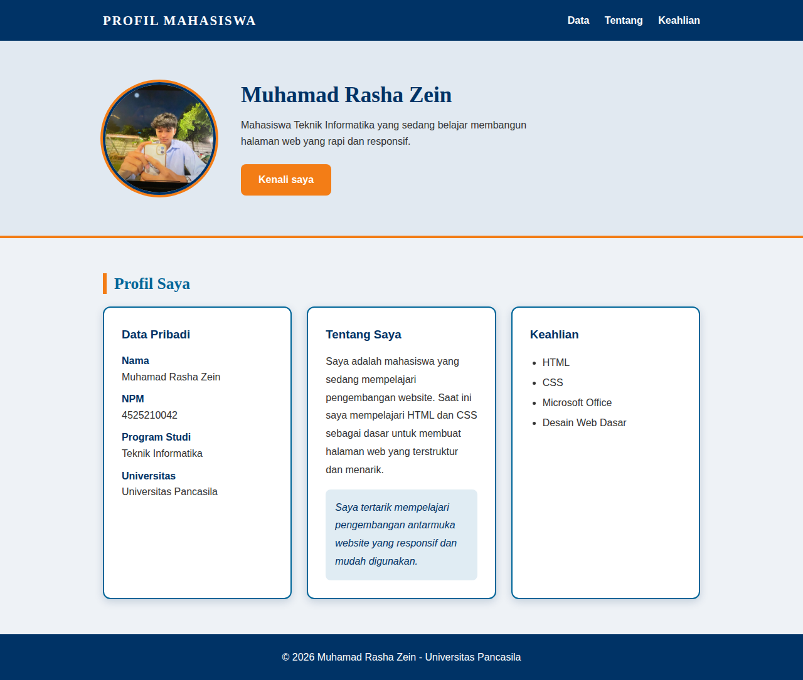
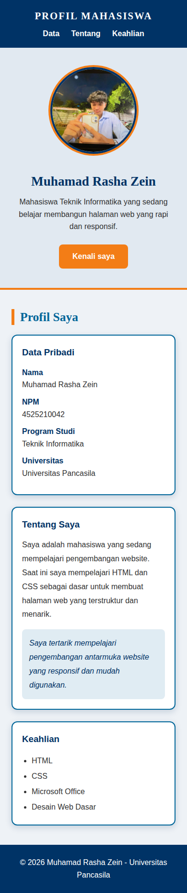
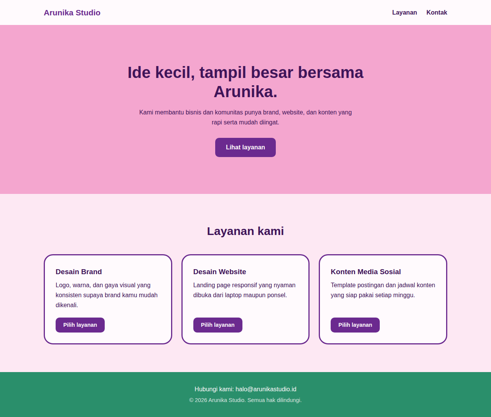
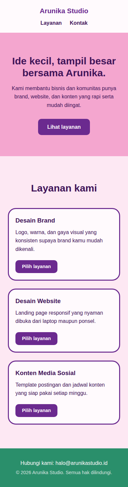

# Tugas Praktikum Pertemuan 4 - Desain Web

**Nama:** Muhamad Rasha Zein
**NPM:** 4525210042
**Kelas:** A

## Tugas Individu
Membangun ulang halaman profil menjadi dua file (`index.html` dan `style.css`) dengan box model, minimal dua class reusable, dan satu media query di bawah 768px.

## File
| File | Keterangan |
|---|---|
| `index.html` | Struktur halaman profil (header, hero, data, tentang, keahlian, footer) |
| `style.css` | Seluruh CSS (tidak ada CSS inline/internal) |
| `img/aca.jpg` | Foto profil |
| `arunika-studio/` | Studi kasus landing page Arunika Studio (sudah dirapikan) |
| `screenshots/` | Tampilan desktop dan mobile |

## Yang Dipakai
- **Box model:** `box-sizing: border-box`, `padding`, `border`, `margin` pada `.container` dan `.card`.
- **Card:** tepat 3 card (Data Pribadi, Tentang Saya, Keahlian); 3 kolom di desktop, 1 kolom di mobile.
- **Class reusable:** `.container`, `.card`, `.section-title`, `.btn`.
- **Media query:** `@media (max-width: 767px)` untuk layar di bawah 768px.

## Screenshot
| Halaman | Desktop | Mobile |
|---|---|---|
| Profil |  |  |
| Arunika Studio |  |  |

## Ringkasan Perubahan, Masalah, dan Solusi
Pada tugas ini saya membangun ulang halaman profil dari pertemuan 3 yang sebelumnya memakai CSS inline menjadi dua file terpisah, yaitu index.html untuk struktur dan style.css untuk tampilan. Perubahan utama adalah memindahkan semua gaya ke satu file CSS, menambah header, hero, dan footer, serta memakai box model lewat padding, border, margin, dan box-sizing border-box agar ukuran elemen mudah dihitung. Saya membuat class reusable seperti container, card, section-title, dan btn sehingga satu aturan dipakai berulang tanpa menulis ulang kode. Masalah yang muncul adalah gaya yang tersebar dan berulang di banyak elemen saat memakai CSS inline, serta tiga card profil yang terlalu sempit jika tetap berjajar di ponsel. Solusinya, gaya dikumpulkan di satu tempat dan saya menambahkan satu media query pada lebar di bawah 768px yang mengubah hero menjadi vertikal dan tiga card menjadi satu kolom. Studi kasus Arunika Studio juga saya rapikan dengan struktur main, tombol rata di dasar card, dan tiga card yang menjadi satu kolom pada layar kecil. Hasilnya sudah diuji pada ukuran desktop dan mobile tanpa scroll horizontal.

## Pembagian Peran
Tugas ini individu, sehingga seluruh pengerjaan (HTML, CSS, pengujian, dokumentasi) dilakukan oleh Muhamad Rasha Zein.
