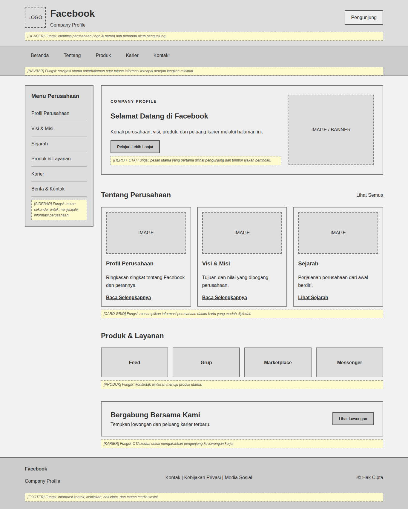
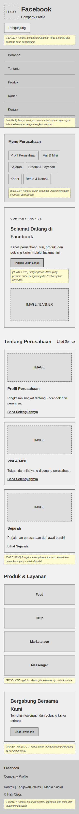

# Tugas Praktikum Pertemuan 5 - Desain Web

**Nama:** Muhamad Rasha Zein
**NPM:** 4525210042
**Kelas:** A

## Tugas Kelompok & Bukti Praktikum
Membuat wireframe desktop dan mobile beserta anotasi fungsi area dengan tema **Company Profile (Facebook)**, dalam dua file (`index.html` dan `style.css`), tingkat fidelitas mid-fidelity.

## File
| File | Keterangan |
|---|---|
| `index.html` | Struktur wireframe (header, navbar, sidebar, hero, card grid, produk dan layanan, karier, footer) |
| `css/style.css` | Seluruh CSS (tidak ada CSS inline/internal) |
| `images/` | Folder aset gambar (10 gambar: logo, hero, card, produk, karier) |
| `dokumentasi/` | Tangkapan layar tampilan desktop dan mobile |

## Struktur Folder
```
pertemuan-05/
├── index.html
├── README.md
├── css/
│   └── style.css
├── images/
│   ├── logo.png
│   ├── hero.png
│   ├── profil.png
│   ├── visi-misi.png
│   ├── sejarah.jpg
│   ├── feed.png
│   ├── grup.png
│   ├── marketplace.png
│   ├── messenger.png
│   └── karier.png
└── dokumentasi/
    ├── tampilan-desktop.png
    ├── tampilan-mobile.png
    └── ringkasan.md
```

## Yang Dipakai
- **Elemen semantik:** `header`, `nav`, `main`, `aside`, `section`, `article`, dan `footer`.
- **Layout:** CSS Grid untuk layout utama (sidebar + konten), hero, card, dan produk; Flexbox untuk header, navbar, dan footer.
- **Gambar:** 10 gambar di folder `images/`, dipasang dengan `` dan `object-fit: cover` agar proporsi terjaga.
- **Anotasi:** catatan kuning pada setiap area yang menjelaskan fungsinya.
- **Media query:** `@media (max-width: 900px)` untuk tablet dan `@media (max-width: 600px)` untuk smartphone.

## Screenshot
| Desktop | Mobile |
|---|---|
|  |  |

## Ringkasan Solusi
Pada tugas ini saya membuat wireframe mid-fidelity bertema Company Profile dengan studi kasus Facebook, dalam dua file terpisah yaitu index.html untuk struktur dan style.css untuk tampilan. Struktur halaman mengikuti anatomi standar, yaitu header, navbar, sidebar, konten utama (hero, card grid, produk dan layanan, ajakan karier), serta footer, dengan elemen semantik agar susunannya jelas. Setiap area diberi anotasi fungsi berupa catatan kuning supaya tujuan tiap bagian mudah dipahami. Gambar yang dipakai sudah dipasang pada tiap area (logo, hero, card, produk, karier) agar proporsi tiap bagian terlihat nyata. Masalah yang muncul adalah sidebar, tiga card, dan navbar yang terlalu sempit jika tetap berjajar di layar kecil. Solusinya, saya menambahkan dua media query: pada lebar maksimal 900px sidebar menjadi menu horizontal dan card menjadi dua kolom, lalu pada lebar maksimal 600px semua elemen disusun satu kolom. Hasilnya sudah diuji pada ukuran desktop dan mobile tanpa scroll horizontal, sehingga kerangka halaman siap dilanjutkan ke tahap mockup visual pada pertemuan berikutnya.

## Pembagian Peran
Tugas ini individu, sehingga seluruh pengerjaan (HTML, CSS, anotasi, pengujian, dokumentasi) dilakukan oleh Muhamad Rasha Zein.
