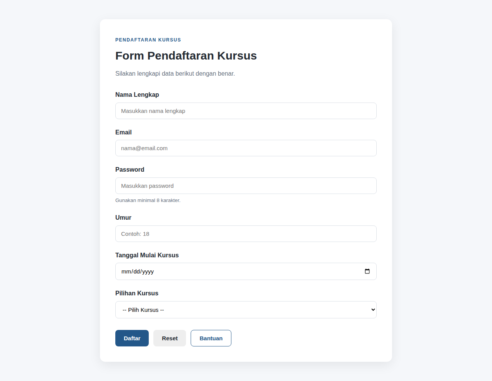
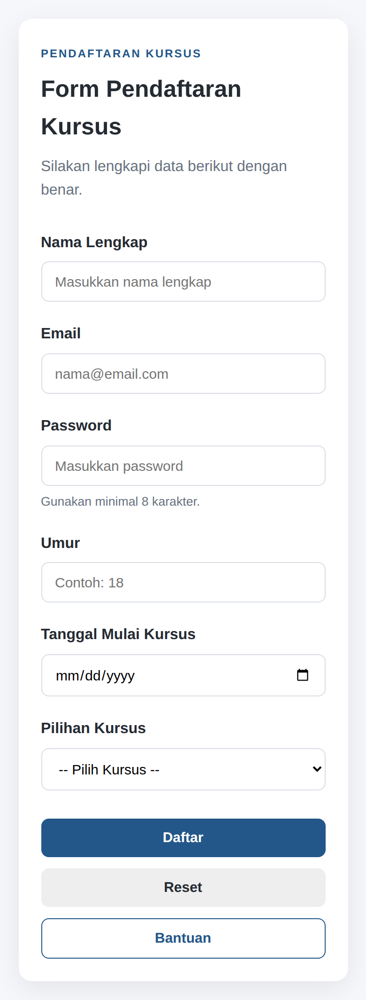
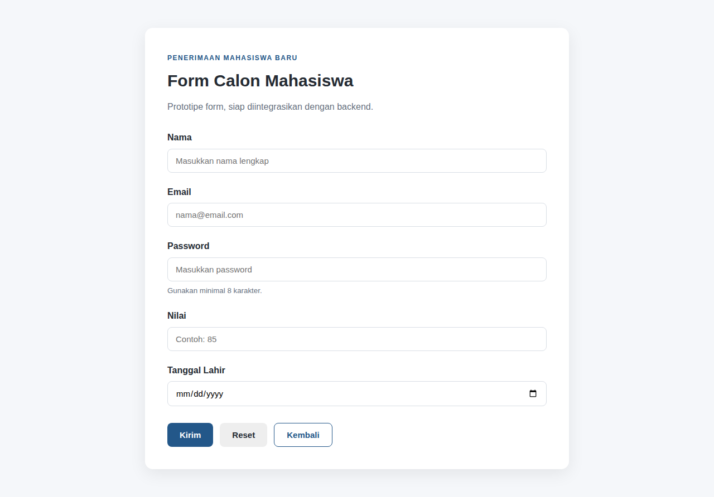
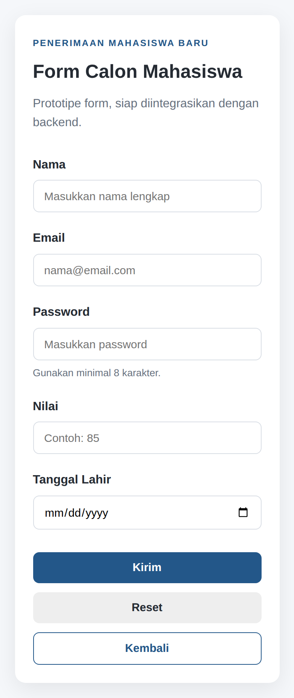

# Praktikum Desain Web - HTML Form Dasar: Input & Pengiriman Data

**Nama:** Muhamad Rasha Zein
**NPM:** [4525210042]

## Struktur Folder

```
latihan/
├── individu/desain-web/pertemuan-07/
│   ├── index.html
│   ├── css/style.css
│   ├── images/
│   └── dokumentasi/   (desktop.png, mobile.png)
└── studi-kasus/desain-web/pertemuan-07/
    ├── index.html
    ├── css/style.css
    ├── images/
    └── dokumentasi/   (desktop.png, mobile.png)
```

## Hasil Tampilan

### Individu - Form Pendaftaran Kursus

| Desktop | Mobile |
|---|---|
|  |  |

### Studi Kasus - Form Penerimaan Mahasiswa Baru

| Desktop | Mobile |
|---|---|
|  |  |

## Ringkasan

Pada praktikum ini saya membuat dua form HTML: form pendaftaran kursus (individu) dan prototipe form penerimaan mahasiswa baru (studi kasus). Perubahan utama yang saya lakukan adalah menyusun setiap field dalam div form-group yang berisi label dan kontrol input, lalu menghubungkannya dengan atribut for pada label yang sama dengan id pada input. Setiap kontrol juga saya beri atribut name supaya datanya punya key saat dikirim ke backend nanti. Form individu memakai lima tipe input, yaitu text, email, password, number, dan date, ditambah select untuk pilihan kursus, serta tiga jenis button: submit, reset, dan button biasa. Form studi kasus memuat nama, email, password, nilai, dan tanggal lahir dengan tipe input yang sesuai.

Masalah yang saya temui adalah memilih method yang tepat dan menjaga agar id dan for tidak salah ketik, karena kalau berbeda maka label tidak terhubung dengan input. Solusinya, saya memakai method post untuk kedua form karena datanya adalah data pendaftaran dan password, bukan pencarian, lalu saya mengecek ulang setiap pasangan for dan id satu per satu. Saya juga menambahkan atribut required, min, dan max agar validasi dasar berjalan di browser. Saya sadar method post tidak otomatis membuat data aman, sehingga HTTPS dan validasi server tetap diperlukan. Tombol reset saya sertakan sesuai tugas, tetapi pada proyek nyata perlu hati-hati karena bisa menghapus isian pengguna secara tidak sengaja.
