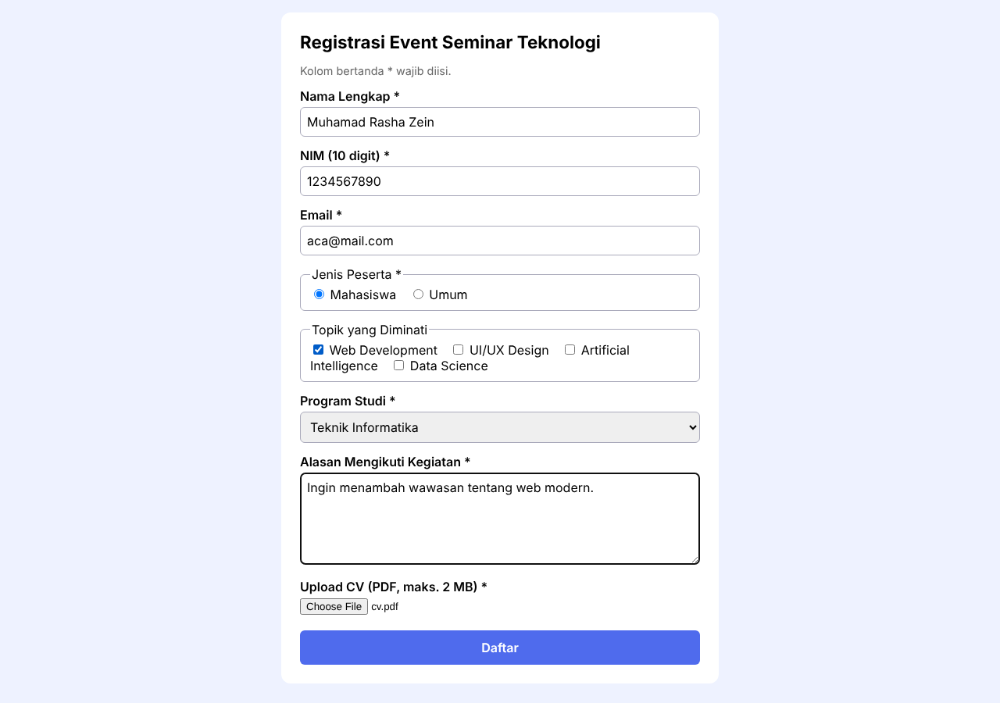
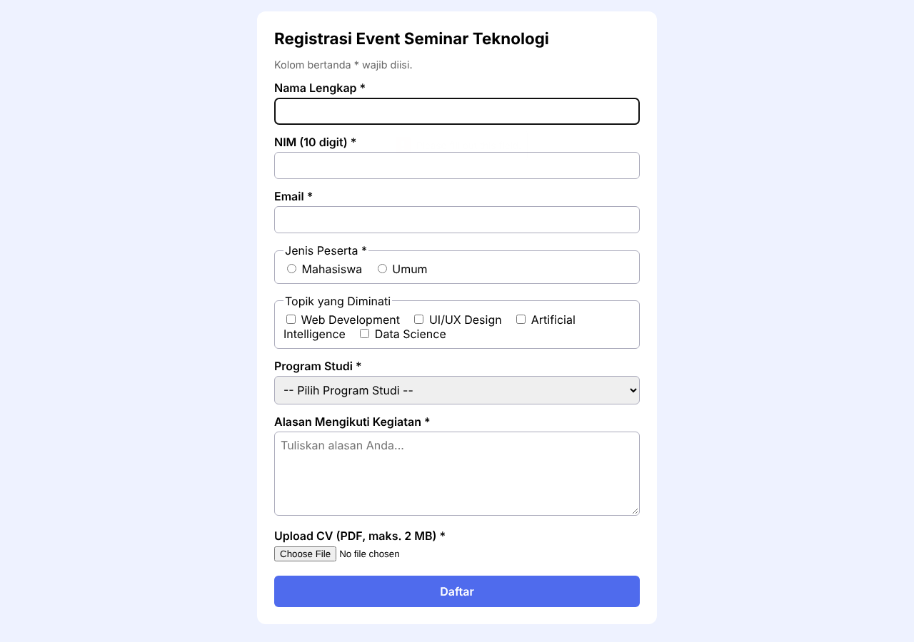
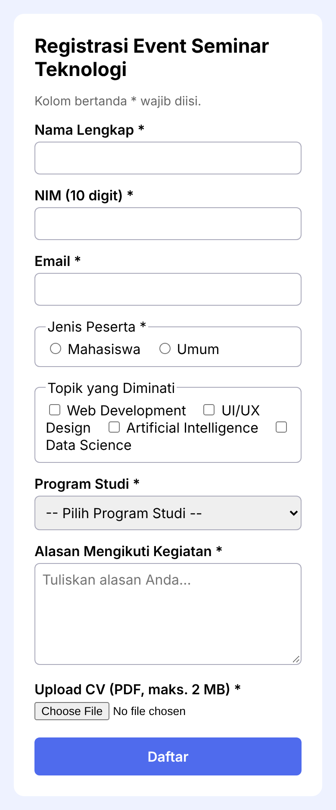
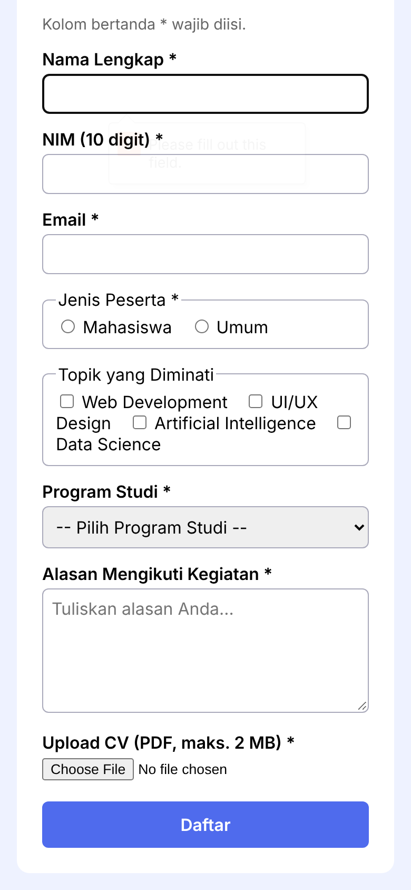

# Tugas Praktikum Pertemuan 8 - Desain Web

**Nama:** Muhamad Rasha Zein  
**NPM:** 4525210042  
**Kelas:** A

## Tugas Individu

Membuat form registrasi event seminar teknologi yang responsif, menggunakan beragam kontrol form HTML, validasi HTML5, serta validasi ulang di sisi server untuk data dan file CV yang diunggah.

## File

| File | Keterangan |
|---|---|
| `index.html` | Form registrasi event seminar teknologi |
| `style.css` | Gaya form dan tampilan responsif |
| `submit.php` | Pemrosesan data, validasi server, dan penyimpanan file CV |
| `ringkasan.md` | Ringkasan praktikum |
| `test-case.md` | Skenario dan hasil pengujian validasi |
| `screenshot/` | Bukti tampilan desktop dan mobile |

## Fitur Form

- Input nama lengkap, NIM, email, jenis peserta, topik minat, program studi, alasan mengikuti kegiatan, dan file CV.
- Kontrol form mencakup radio button, checkbox, select, textarea, dan upload file.
- Validasi HTML5 menggunakan `required`, `minlength`, `maxlength`, `pattern`, dan tipe input email.
- Form dapat digunakan pada tampilan desktop maupun mobile.
- Server memvalidasi ulang data, pilihan yang diizinkan, serta ukuran dan MIME file CV. File yang diterima disimpan dengan nama acak.

## Hasil Tampilan

### Desktop

| Form terisi | Validasi wajib diisi |
|---|---|
|  |  |

### Mobile

| Form registrasi | Validasi wajib diisi |
|---|---|
|  |  |

## Ringkasan Solusi

Pada praktikum ini saya membuat form registrasi event seminar teknologi dengan berbagai jenis kontrol HTML dan tampilan responsif. Validasi di browser membantu pengguna mengisi kolom wajib, mengikuti batas panjang teks, memasukkan NIM 10 digit, dan mengisi email dengan format yang benar. Pengujian menunjukkan bahwa atribut `accept=".pdf"` hanya membantu memfilter pilihan file dan tidak cukup untuk memastikan file yang diunggah benar-benar PDF. Karena itu, `submit.php` memvalidasi ulang data dan memeriksa ukuran serta MIME file di server. Checkbox topik minat dibuat opsional karena HTML tidak menyediakan validasi bawaan untuk mewajibkan minimal satu checkbox dalam satu grup. Data yang ditampilkan kembali di-escape, dan file disimpan menggunakan nama acak. Hasil tampilan dan pengujian dicatat dalam folder screenshot dan `test-case.md`.

## Cara Menjalankan

Jalankan proyek melalui server lokal yang mendukung PHP, lalu buka `index.html` melalui server tersebut agar pengiriman form ke `submit.php` dapat diproses.

## Pembagian Peran

Tugas ini dikerjakan secara individu oleh Muhamad Rasha Zein, termasuk pembuatan form, styling, validasi, pengujian, dan dokumentasi.
